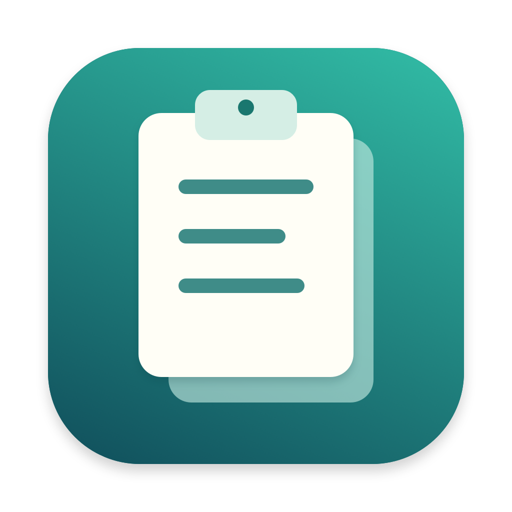
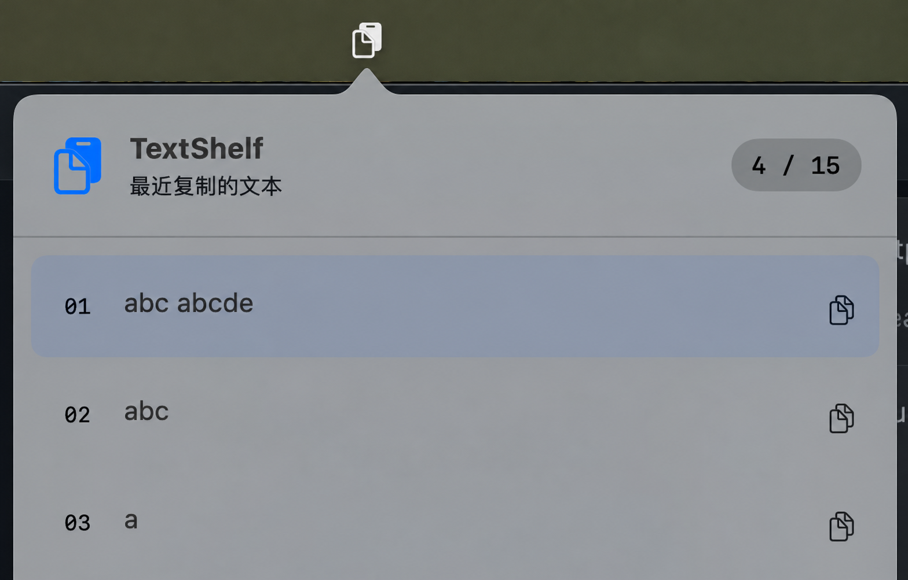

# TextShelf



A small macOS menu bar app that keeps your 15 most recent text clips. Preview a clip, click to copy it, then paste wherever you need it.

## Screenshot



The current app interface is in Chinese. Unrelated menu bar icons have been removed from this screenshot.

## Features

- Lives in the menu bar, with no Dock icon.
- Automatically keeps up to 15 distinct text clips, newest first.
- Hover over a clip to preview its full text.
- Click a clip to copy its original text and close the panel, then press `⌘V` to paste.
- Copying from history preserves the list order. Copying an existing clip in another app moves it to the top.
- Click outside the panel or press `Esc` to dismiss it. Use the button at the bottom to quit.

History stays in memory and is cleared when you quit. No account or network connection is needed. Images and files are not recorded. Line breaks, whitespace, and Unicode are preserved. Clipboard content marked with `org.nspasteboard.ConcealedType` is ignored.

## Build and run

Requires macOS 13 or later and a Swift 6 toolchain. Xcode Command Line Tools is sufficient; there are no third-party dependencies.

```sh
git clone https://github.com/sharding-db/TextShelf.git
cd TextShelf
./scripts/build.sh
open dist/TextShelf.app
```

You can also double-click `dist/TextShelf.app`, or drag it into your Applications folder.

The build script generates the app icon, packages the app, and applies an ad hoc signature for local use. It keeps the previous app bundle under `.build/` so an existing instance can continue running.

## Checks

```sh
./scripts/check.sh
```

The checks use isolated temporary pasteboards, leaving your system clipboard untouched. They cover history capacity, exact text preservation, deduplication, restoring clips, copies arriving between timer ticks, and image, file, and concealed-content filtering.

The script also checks the native view layout with an empty history and 15 clips, reports code coverage, and verifies the app signature. It runs with Command Line Tools alone, without XCTest or a third-party test framework.

## Notes

- Clipboard changes are checked every 250 ms. Multiple copies within one polling interval may only capture the last value.
- History is not saved across app restarts.
- The app copies selected text to the clipboard; paste it into the destination app with `⌘V`.
